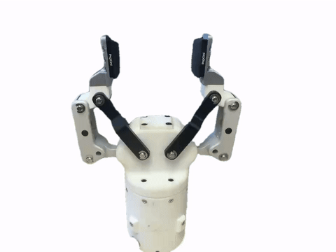

**中文** | [English](README.en.md)

# GripperOne

<p align="center"></p>
<p align="center">开合演示（<a href="docs/media/gripper_demo.mp4">带声音的 MP4</a>）</p>
<p align="center"><a href="https://huggingface.co/datasets/AlfredZhang98/robot-gripper-assets"></a> </p>

**GripperOne** 是一个基于开源夹爪工程进一步改造的项目，结合了压力传感器和完整无线控制电路，目标是在原有夹爪基础上提升感知能力与控制便利性。

## 项目来源

- 原始开源夹爪工程：<https://github.com/Ragtime-LAB/RhinoV2.0_Gripper>
- 电机/执行器型号：达妙科技 DM-J4310-2EC v1.2

## 项目特点

- 基于开源夹爪工程进行二次开发
- 集成帕西尼 CP-M3025 触觉指腹（两指），按触觉力闭环定力夹取
- 集成完整无线控制电路：USB、蓝牙、Wi-Fi 三种连接使用同一套协议
- 主控为 Seeed Studio XIAO ESP32-C6，固件基于原生 ESP-IDF
- 约 **3000 元（约 420 美元）** 即可复刻一台（其中帕西尼触觉传感器约 1500 元），见 [BOM](hardware/bom/BOM.md)
- 提供 Isaac Sim 仿真资产（OpenUSD），见[仿真资产](#仿真资产isaac-sim)

## 仓库结构

```
GripperOne/
├─ hardware/                硬件
│  ├─ bom/                  物料清单（BOM.md / BOM.xlsx / 样图）
│  ├─ cad/                  SolidWorks 三维模型（Git LFS）
│  ├─ pcb/                  主控 PCB 原理图、版图（Altium）和生产文件
│  ├─ datasheets/           电机、触觉传感器、IMU 厂家资料
│  └─ WIRING.md             引脚、接线、供电、PCB 接口
├─ firmware/                固件：ESP-IDF 工程（XIAO ESP32-C6）
│  ├─ main/                 入口、引脚表 app_pins.h、配置 app_config.h
│  └─ components/           电机、触觉、IMU、夹爪、通信等模块
├─ host/                    上位机（Python）
│  ├─ 4_gripper_gui.py      夹爪图形界面
│  ├─ 3_gripper_cli.py      夹爪命令行
│  ├─ 2_haptic_uart.py      触觉传感器调试界面
│  └─ 1_imu_gui.py          IMU 调试界面
└─ docs/                    使用手册、通信协议、夹爪控制说明
```

所有文档都有中文（`X.md`）和英文（`X.en.md`）两个版本。

## 文档

| 文档 | 内容 |
| --- | --- |
| [hardware/README.md](hardware/README.md) | 硬件总览、三维模型、加工说明 |
| [hardware/bom/BOM.md](hardware/bom/BOM.md) | 物料清单（Excel：[BOM.xlsx](hardware/bom/BOM.xlsx)） |
| [hardware/WIRING.md](hardware/WIRING.md) | 引脚分配、接线和供电 |
| [firmware/README.md](firmware/README.md) | 固件结构、编译烧录、配置 |
| [docs/USER_MANUAL.md](docs/USER_MANUAL.md) | 使用手册：连接（USB / 蓝牙 / Wi-Fi）、首次使用、控制 |
| [docs/GRIPPER_CONTROL.md](docs/GRIPPER_CONTROL.md) | 夹爪电机控制：实测结果、参数范围、电流计算 |
| [docs/PROTOCOL.md](docs/PROTOCOL.md) | 用户通信协议和夹爪应用层行为 |
| [Hugging Face 数据集](https://huggingface.co/datasets/AlfredZhang98/robot-gripper-assets) | Isaac Sim 仿真资产（OpenUSD / SimReady） |

## 仿真资产（Isaac Sim）

本夹爪的 Isaac Sim 仿真资产发布在 Hugging Face：[AlfredZhang98/robot-gripper-assets](https://huggingface.co/datasets/AlfredZhang98/robot-gripper-assets)（CC BY 4.0）。

- 本夹爪对应 `gripper_custom/`（另附 CTAG2F90-D 夹爪 `gripper_ctag2f90d/` 作对照）。
- 格式为 OpenUSD，按 NVIDIA SimReady 规范打包：入口 `usd/gripper_custom.usda`，几何、物理分别在 `usd/payloads/` 中；保留关节（7 个刚体、6 个转动关节）。
- PhysX 和 Newton 两套物理参数分开存放，默认都关闭，使用时只启用其中一个。官方 benchmark 测试两种引擎各 17 项通过、0 项失败。
- 质量、惯量、驱动和接触参数是仿真估计值，不是硬件实测标定，详见数据集 README。

下载：

```bash
pip install -U "huggingface_hub[cli]"
huggingface-cli download AlfredZhang98/robot-gripper-assets --repo-type dataset --include "gripper_custom/*" --local-dir robot-gripper-assets
```

## 快速开始

1. 按 [BOM](hardware/bom/BOM.md) 备料、加工，按 [硬件说明](hardware/README.md) 装配，按 [WIRING.md](hardware/WIRING.md) 接线。

   > ⚠️ XIAO 的 USB 供电和 PCB 上 DC-DC 模块的供电不能同时接入。开发阶段建议不焊 DC-DC 模块，见 [WIRING.md](hardware/WIRING.md#2-电源)。

2. 编译并烧录固件（需已导出 ESP-IDF 环境）：

   ```bash
   cd firmware
   idf.py set-target esp32c6
   idf.py -p <端口> build flash
   ```

3. 安装上位机依赖并打开图形界面：

   ```bash
   pip install -r host/requirements.txt
   python host/4_gripper_gui.py
   ```

   首次使用先做完整标定，之后每次开机做原点检查，见 [使用手册](docs/USER_MANUAL.md)。

## 致谢

感谢芝士榴莲肥牛 <https://github.com/wEch1ng> 的支持。
