**中文** | [English](BOM.en.md)

# 物料清单（BOM）

约 **1500 元（约 220 美元）** 即可复刻一台。Excel 版本：[BOM.xlsx](BOM.xlsx)，与本页内容一致，改动时两边一起改。

丝杆和丝杆螺母的供应商：[繁展金属制品有限公司](https://shop213748648.taobao.com)（淘宝）。

| 序号 | 类别 | 名称 | 样图 | 规格 / 型号 | 数量 | 工艺 / 材料 | 来源 / 链接 | CAD 文件 | 备注 |
| --- | --- | --- | --- | --- | --- | --- | --- | --- | --- |
| 1 | 结构件 | 转子丝杆传动件 | 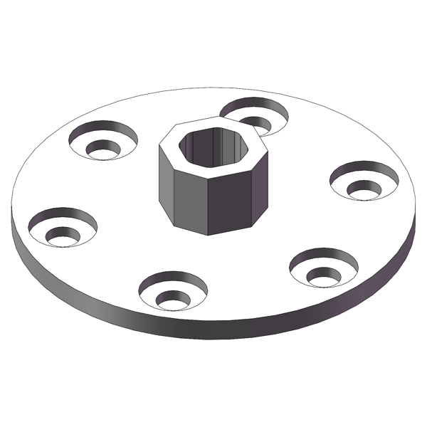 |  | 1 | CNC | 铨洲 CNC | 转子丝杆传动件 |  |
| 2 | 结构件 | 螺母连杆 | 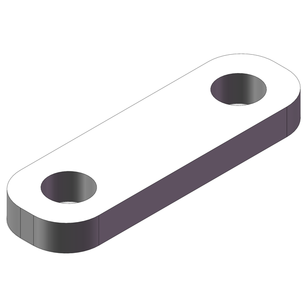 | 304 不锈钢 | 4 | CNC | 铨洲 CNC | 螺母连杆 | 受力大，材料用 304 不锈钢 |
| 3 | 结构件 | 底盖 | 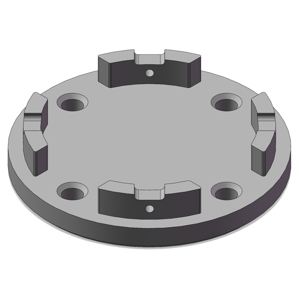 |  | 1 | 3D 打印（PETG） |  | urconnector | 不建议光固化：热熔螺母在光固化件里熔接效果差 |
| 4 | 结构件 | 电机外壳 | 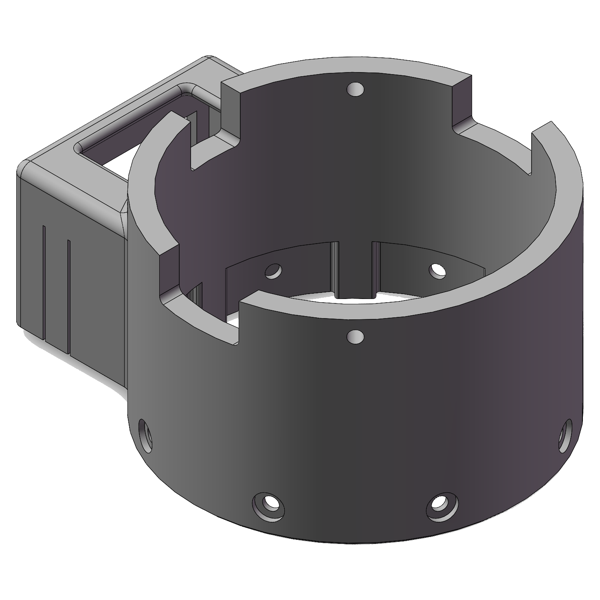 |  | 1 | 3D 打印（PETG） |  | motor_out | 不建议光固化：热熔螺母在光固化件里熔接效果差 |
| 5 | 结构件 | 外壳 | 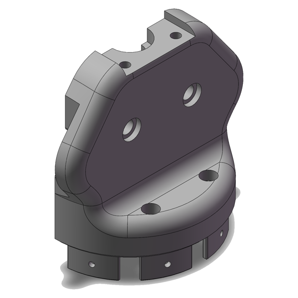 |  | 2 | 3D 打印（PETG） |  | 外壳 | 不建议光固化：热熔螺母在光固化件里熔接效果差 |
| 6 | 结构件 | 电路仓外壳 | 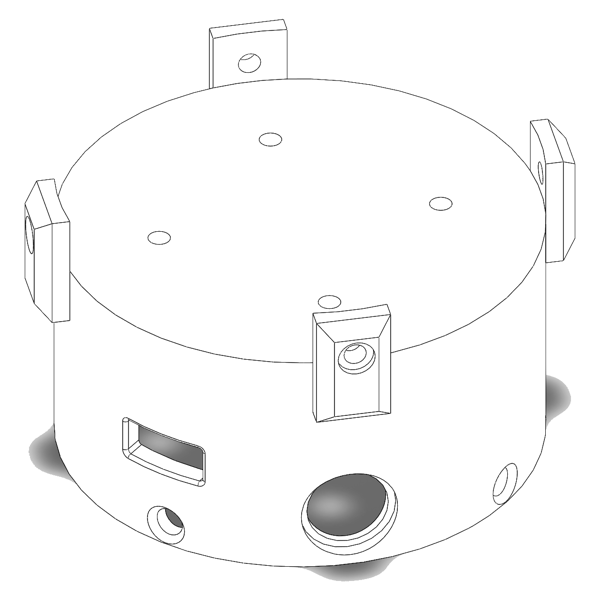 |  | 1 | CNC |  | upper | 新设计新增：装主控 PCB，侧面开 USB 口 |
| 7 | 结构件 | 主动杆 | 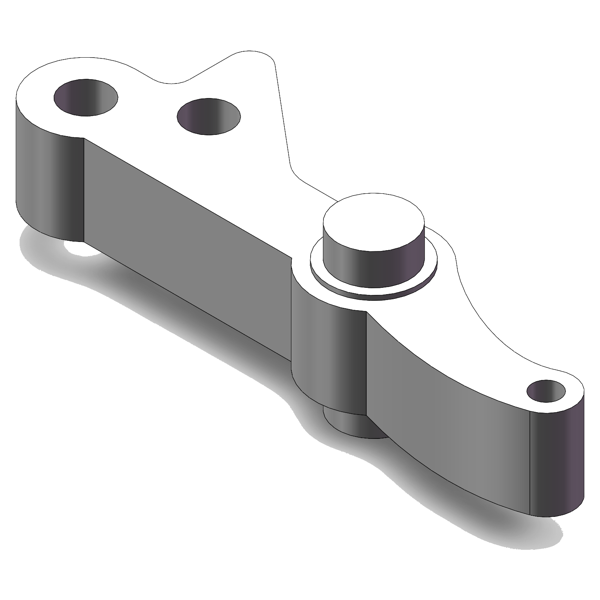 |  | 2 | CNC | 铨洲 CNC | 主动杆 |  |
| 8 | 结构件 | 欠驱动杆 | 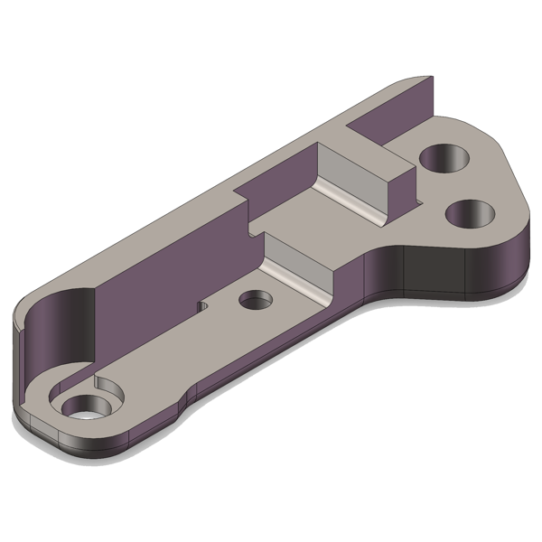 |  | 2 | CNC | 铨洲 CNC | 镜向欠驱动杆 |  |
| 9 | 结构件 | 欠驱动杆（镜像） | 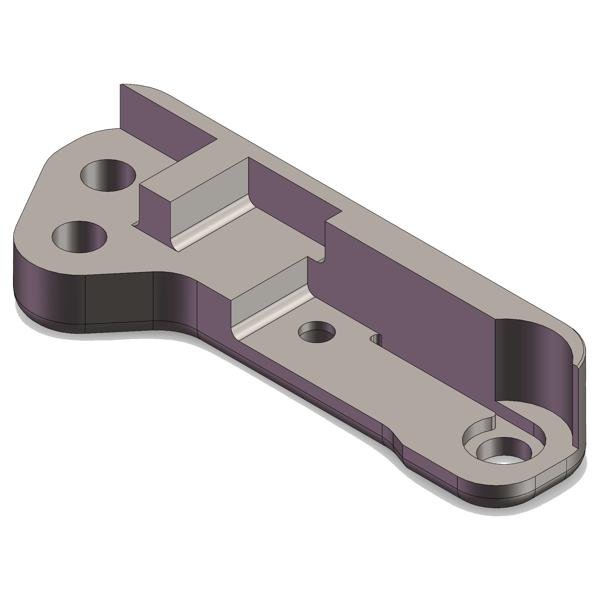 |  | 2 | CNC | 铨洲 CNC | 镜向欠驱动杆-镜像 |  |
| 10 | 结构件 | 手指连杆 | 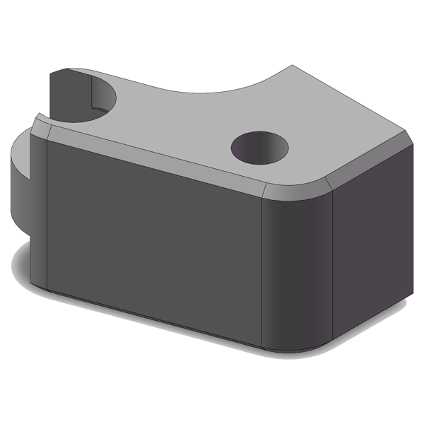 |  | 2 | 3D 打印（PETG） |  | 手指连杆 | 不建议光固化：热熔螺母在光固化件里熔接效果差 |
| 11 | 结构件 | 从动杆 | 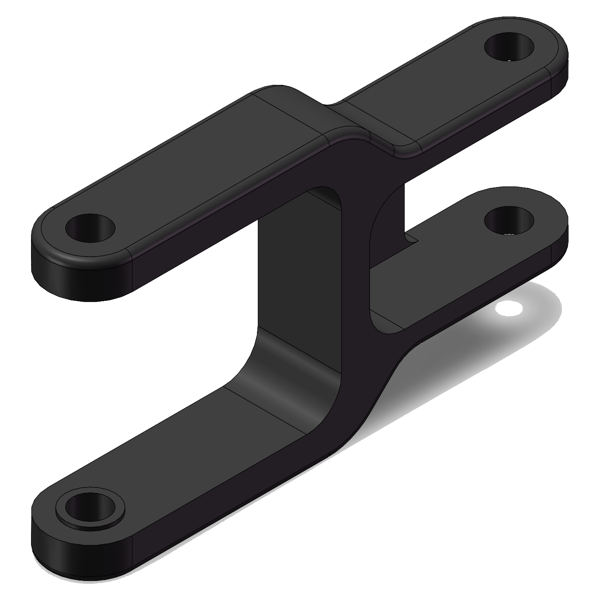 |  | 2 | CNC | 铨洲 CNC | 从动杆 |  |
| 12 | 结构件 | 手指 | 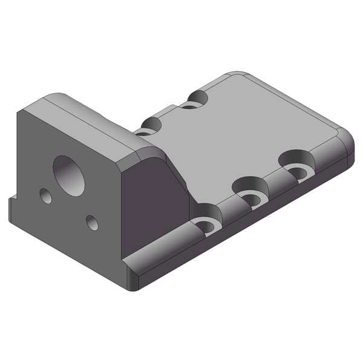 |  | 2 | 3D 打印（PETG） |  | 手指v2 | 不建议光固化：热熔螺母在光固化件里熔接效果差 |
| 13 | 结构件 | 挡盖 | 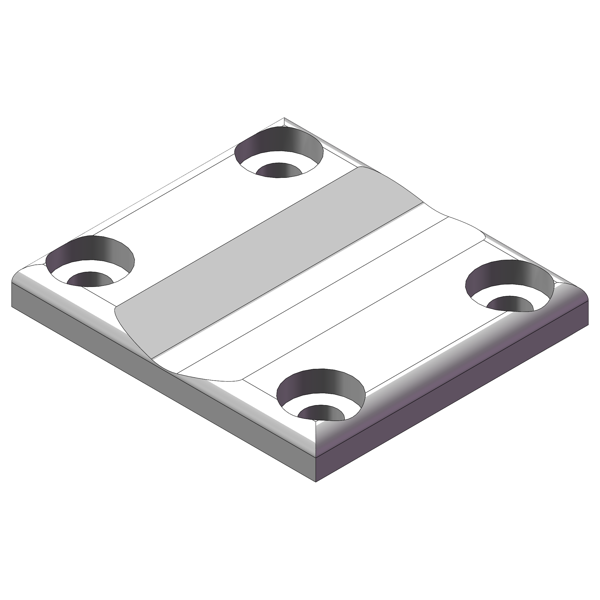 |  | 1 | 3D 打印（PETG） |  | 挡盖 | 不建议光固化：热熔螺母在光固化件里熔接效果差 |
| 14 | 传动件 | 丝杆 | 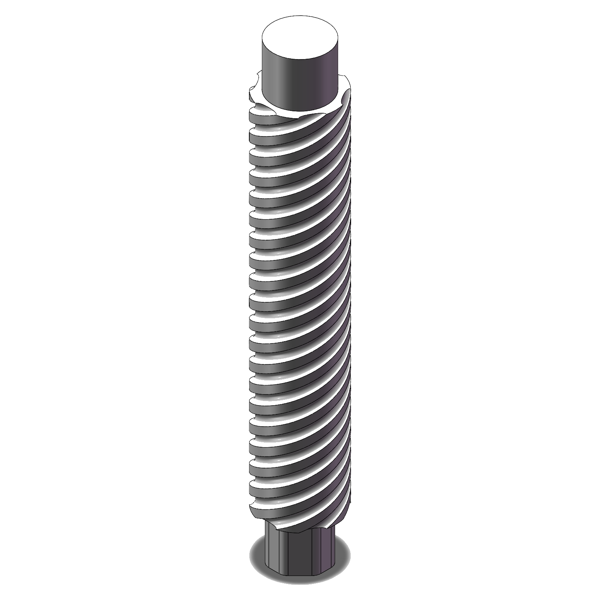 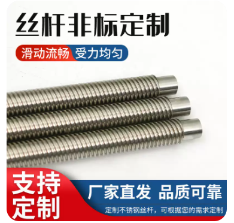 | 304 不锈钢 T8×2 梯形丝杆；订单链接的规格页显示“正反牙 T8×2×200 mm + 2 只螺母”，请核对 | 1 | 定制长度 / 端部加工 | [繁展金属制品（淘宝）](https://item.taobao.com/item.htm?id=719659221034&skuId=5016268544734) | 丝杆 | 建议改为标准件，见“优化建议” |
| 15 | 传动件 | 丝杆螺母 | 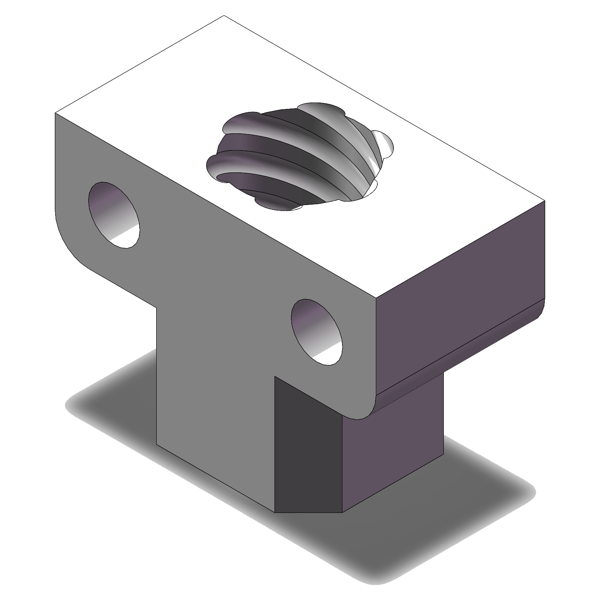 | T8×2 黄铜螺母 | 1 | 黄铜 | [繁展金属制品（淘宝）](https://item.taobao.com/item.htm?id=719659221034&skuId=5016268544734) | 丝杆螺母 | 与丝杆同店购买；建议改为标准法兰铜螺母 |
| 16 | 轴承 | 小法兰轴承 | 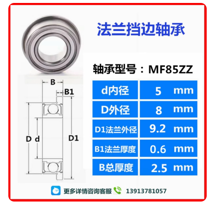 | MF85ZZ（5×8×9.2×0.6×2.5） | 4 |  | [淘宝](https://item.taobao.com/item.htm?id=627537372468) |  |  |
| 17 | 轴承 | 法兰轴承 | 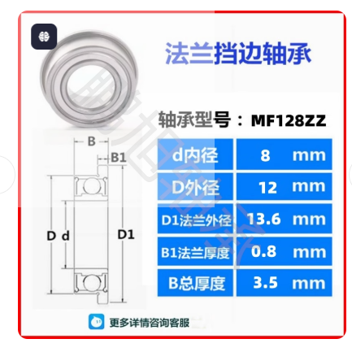 | MF128ZZ（8×12×13.6×0.8×3.5） | 4 |  | [淘宝（同上店）](https://item.taobao.com/item.htm?id=627537372468) |  |  |
| 18 | 轴承 | 深沟球轴承 | 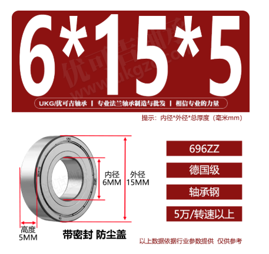 | 6×15×5，带密封 | 1 |  | [天猫](https://detail.tmall.com/item.htm?id=735576032715) | 轴承5_15_5 | CAD 文件名为 5×15×5，BOM 为 6×15×5，需核对内径 |
| 19 | 标准件 | 双头带槽销轴（含卡簧） | 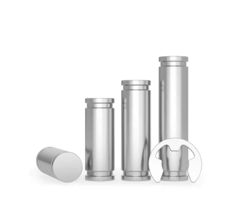 | M5×30（Ø5 × 30 mm） | 6 |  | [天猫](https://detail.tmall.com/item.htm?id=617648776883&skuId=5533509412784) |  |  |
| 20 | 标准件 | 双头带槽销轴（含卡簧） |  | M5×45（Ø5 × 45 mm） | 2 |  | [天猫（同上）](https://detail.tmall.com/item.htm?id=617648776883) | 双头卡簧销轴m5-45 |  |
| 21 | 标准件 | 对锁螺丝 | 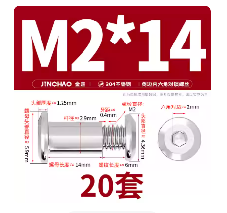 | M2×14 | 4 |  | [天猫](https://detail.tmall.com/item.htm?id=738916254976) |  | 一包 20 套 |
| 22 | 标准件 | 扭簧 | 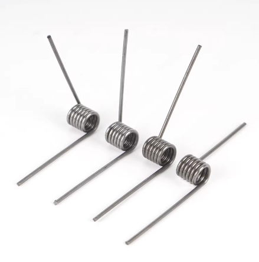 | 线径 1.2，外径 7.5，5 圈，180° | 2 |  | [天猫](https://detail.tmall.com/item.htm?id=774983364150) |  | 左旋、右旋各 1 个（一包 10 个） |
| 23 | 标准件 | 内六角圆柱头螺钉（杯头） |  | M5×6，GB/T 70.1 / ISO 4762 | 待补充 |  |  |  |  |
| 24 | 标准件 | 内六角圆柱头螺钉（杯头） |  | M3×6，GB/T 70.1 / ISO 4762 | 待补充 |  |  |  |  |
| 25 | 标准件 | 内六角圆柱头螺钉（杯头） |  | M3×5，GB/T 70.1 / ISO 4762 | 待补充 |  |  |  |  |
| 26 | 标准件 | 内六角扁平头螺钉 |  | M2.5×3 | 待补充 |  |  |  |  |
| 27 | 标准件 | 内六角沉头螺钉 |  | M3×6，GB/T 70.3 / ISO 10642 | 待补充 |  |  |  |  |
| 28 | 标准件 | 热熔螺母 |  | 待补充 | 待补充 |  |  |  | 原 BOM 未列出，但打印件需要 |
| 29 | 执行器 | 关节电机 | 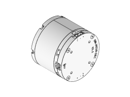 | 达妙 DM-J4310-2EC V1.2，10:1，24 V | 1 |  | 达妙科技 | DM-J4310-2EC-V1.1_3d | 链接待补充 |
| 30 | 电子 | 主控板 | 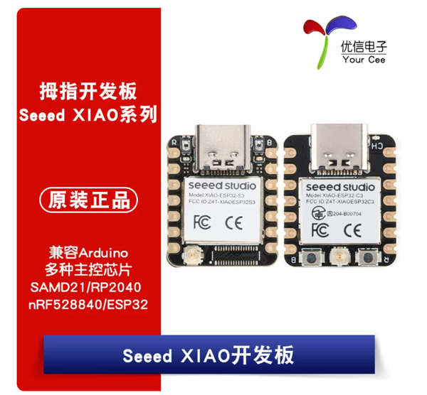 | Seeed Studio XIAO ESP32-C6（PCB 位号 Sub1） | 1 |  | [天猫](https://detail.tmall.com/item.htm?id=779487558268) |  |  |
| 31 | 电子 | CAN 收发器模块 | 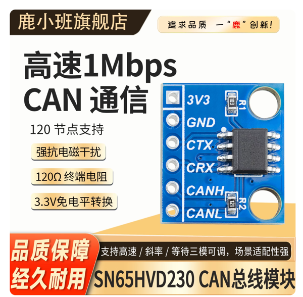 | 3.3 V，6 针 2.54 mm（Sub3） | 1 |  | [天猫](https://detail.tmall.com/item.htm?id=1026039679688&skuId=6203293530777) |  | ESP32-C6 只有 TWAI 控制器，必须外接收发器 |
| 32 | 电子 | IMU | 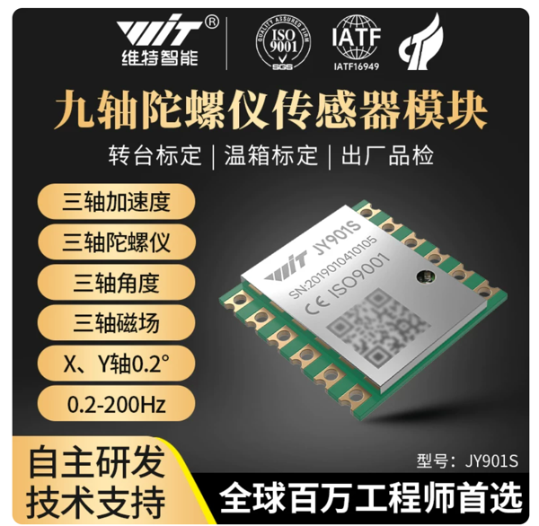 | 维特智能 JY901P（Sub2） | 1 |  | [淘宝](https://item.taobao.com/item.htm?id=995918759607) |  |  |
| 33 | 电子 | 24 V→5 V DC-DC 模块 | 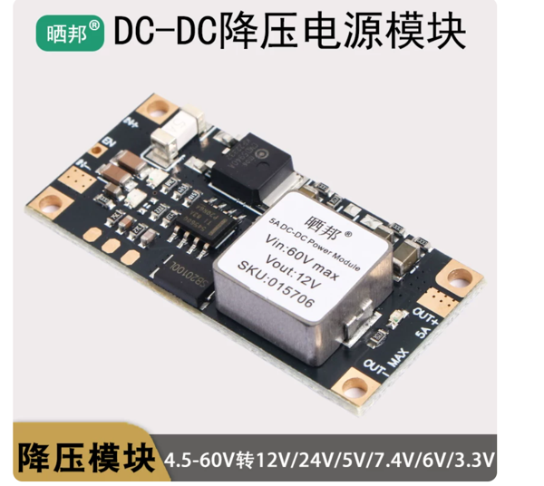 | PCB 位号 P1 | 1 |  | [淘宝](https://item.taobao.com/item.htm?id=908768946162) |  | 不能与 XIAO 的 USB 供电同时接入；开发阶段建议不焊 |
| 34 | 电子 | LDO 稳压芯片 | 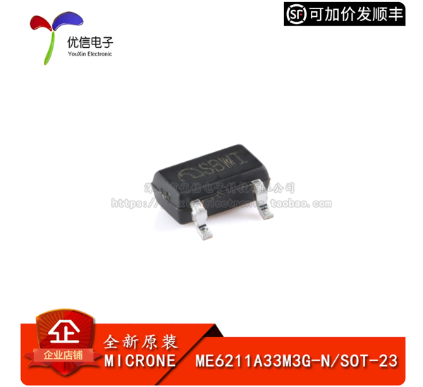 | ME6211A33M3G-N，3.3 V，SOT-23（IC1） | 1 |  | [淘宝](https://item.taobao.com/item.htm?id=823005831436) |  |  |
| 35 | 电子 | 主控 PCB | 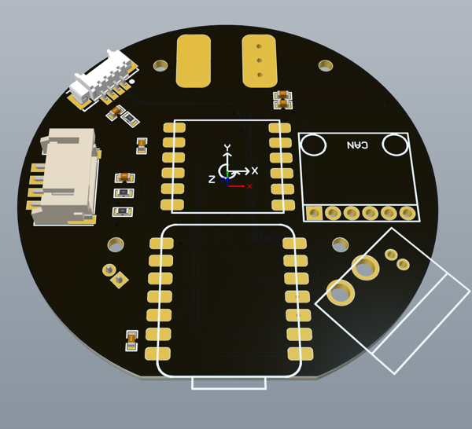 | 双层板，生产文件 hardware/pcb/production.zip | 1 | PCB 打样（如嘉立创） |  | gripper_arm_BOARD | 阻容等贴片元件见“PCB 元件”表 |
| 36 | 电子 | XT30(2+2) 插座 | 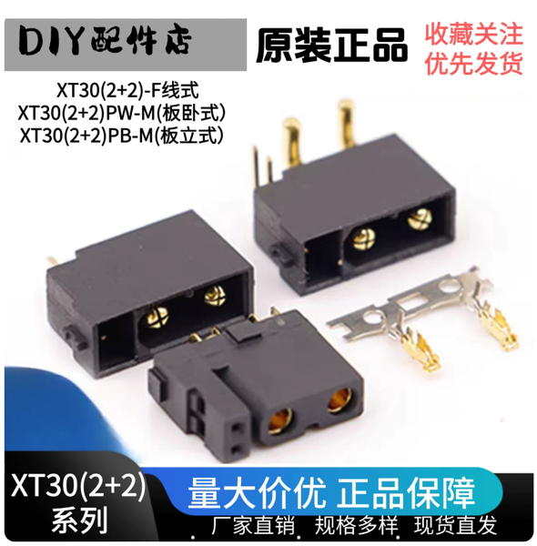 | 电机供电 + CAN（Con2） | 1 |  | [淘宝](https://item.taobao.com/item.htm?id=892794165229) |  |  |
| 37 | 电子 | XT30(2+2) 电机线 | 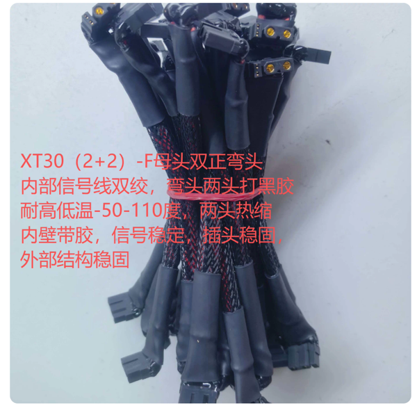 | 配 Con2，接 DM-J4310 | 1 |  | [淘宝](https://item.taobao.com/item.htm?id=1043911293012) |  |  |
| 38 | 电子 | 24 V 直流电源适配器 | 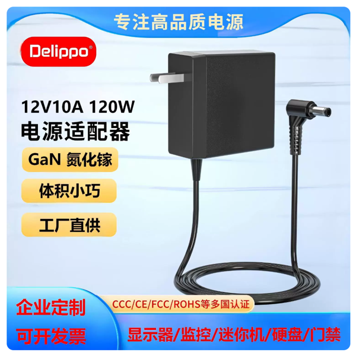 | 24 V，DELIPPO 氮化镓适配器（店铺主图为 12 V 款，下单选 24 V） | 1 |  | [淘宝](https://item.taobao.com/item.htm?id=900740020964) |  | 给电机和 PCB 供电 |
| 39 | 电子 | 24 V 供电线 | 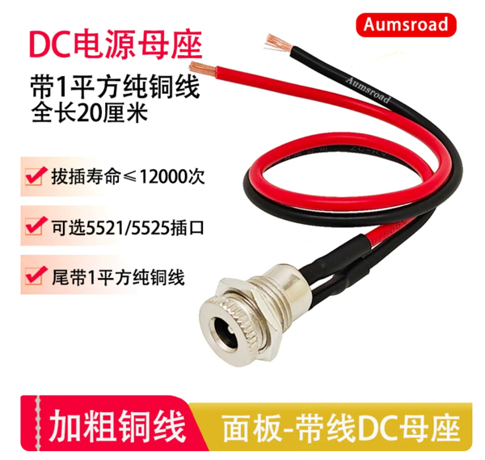 | 接 PCB 24 V 输入焊盘（Con1） | 1 |  | [天猫](https://detail.tmall.com/item.htm?id=927221788917) |  |  |
| 40 | 电子 | MX1.25 4P 卧贴座 | 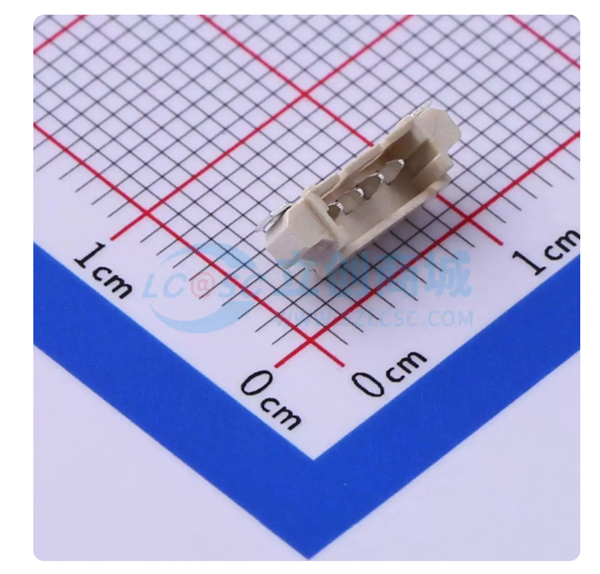 | PCB → 触觉集成板（connect in1） | 1 |  | [淘宝](https://item.taobao.com/item.htm?id=1011820309391) |  |  |
| 41 | 电子 | MX1.25 4P 连接线 | 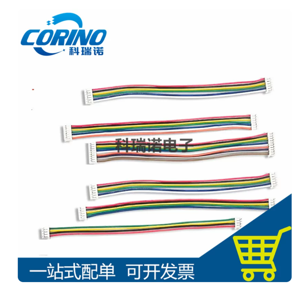 | PCB ↔ 触觉集成板 UART | 1 |  | [淘宝](https://item.taobao.com/item.htm?id=1037011788971) |  | 分同向 / 反向，按 WIRING.md 第 3 节核对引脚后再买 |
| 42 | 电子 | PH2.0 4P 卧贴座 | 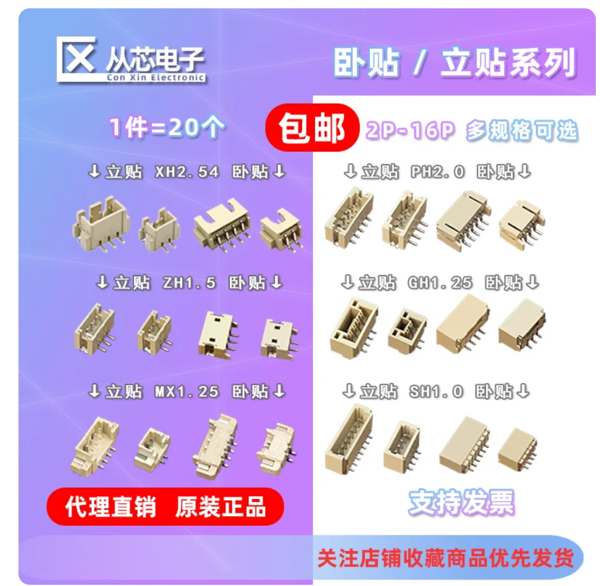 | 外接显示屏（OLED1），注意是 PH2.0 | 1 |  | [淘宝](https://item.taobao.com/item.htm?id=849667026616) |  | 可选 |
| 43 | 电子 | 1.3 inch OLED 屏 | 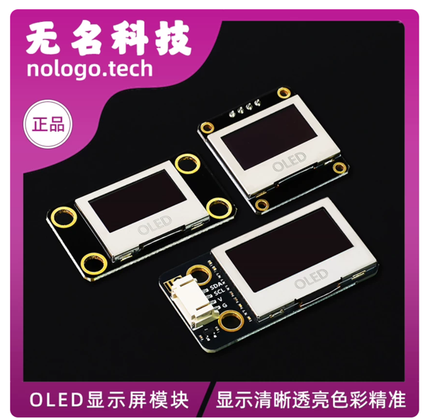 | SH1106，I2C | 1 |  | [淘宝](https://item.taobao.com/item.htm?id=678589112969) |  | 可选；当前固件未驱动 |
| 44 | 电子 | 触觉传感器指腹 | 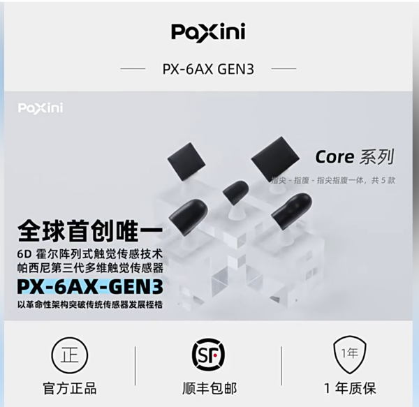 | 帕西尼 PX6AX-GEN3-CP-M3025-Core | 2 |  | [天猫](https://detail.tmall.com/item.htm?id=961726831317&skuId=6078300404563) | Finger pad 指腹 M3025 | 帕西尼已出夹爪专用 GEN4，可替换（固件按 GEN3 协议实现，替换需验证） |
| 45 | 电子 | 触觉高速通信集成板 | 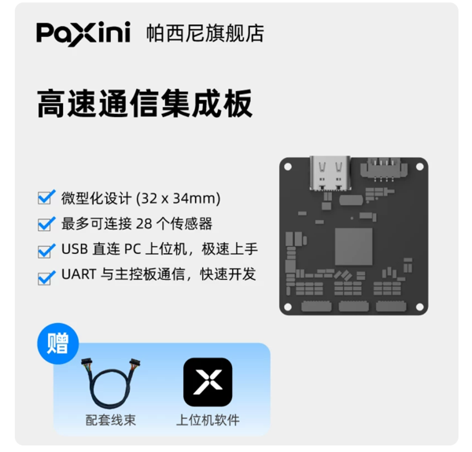 | 帕西尼 PX-6AX GEN3 | 1 |  | [天猫](https://detail.tmall.com/item.htm?id=961726831317&skuId=6243788931561) |  | 需 4.5–5 V 供电，不能接 3V3 |
| 46 | 电子 | 触觉传感器加长连接线 | 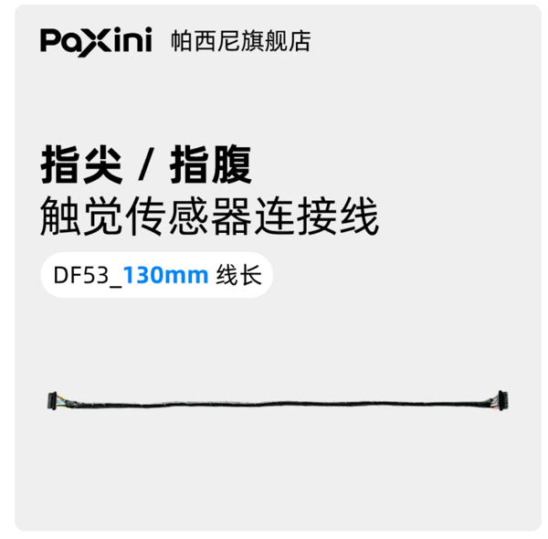 | 传感器 ↔ 集成板 | 2 |  | [天猫](https://detail.tmall.com/item.htm?id=965246600488&skuId=6243521550639) |  | 原配线太短，必须购买；每个传感器 1 根 |

## PCB 元件

来自 Altium 导出的 [`../pcb/production.zip`](../pcb/production.zip) 中的 `bom_electrical.xlsx`，阻容可在嘉立创 SMT 或立创商城购买。

| Comment | 位号 | 封装 | LibRef | 数量 |
| --- | --- | --- | --- | --- |
| 0.1uf | C1, C2, C5, C6 | C 0603_L | C | 4 |
| 1uF | C3 | C 0603_L | C | 1 |
| 10uf | C4 | C 0603_L | C | 1 |
| 1uF | C8, C11 | C0402_L | C | 2 |
| 10uF | C9 | C0402_L | C | 1 |
| 100nF | C10 | C0402_L | C | 1 |
| 24v_input_pad | Con1 | high volt input | 24v_input_pad | 1 |
| xt30_2_2 | Con2 | xt30_2_2 | xt30_2_2 | 1 |
| HDR-1X4 | connect in1 | MX 1.25-WS-4P | Header 4 | 1 |
| ME6211A33M3G-N | IC1 | SOT95P280X145-3N | ME6211A33M3G-N | 1 |
| HDR-1X2 | JP1 | PH2.0-WI-2P | Header 2 | 1 |
| HDR-1X4 | OLED1 | PH2.0-WS-4P | Header 4 | 1 |
| DC_module | P1 | xibang_24v_dc | DC_module | 1 |
| 4.7k | R1, R2 | R 0603_L | R | 2 |
| 0(NC) | R3 | R 0603_L | R | 1 |
| esp32_c6_xiao | Sub1 | esp32_c6_xiao | esp32_c6_xiao | 1 |
| JY901x | Sub2 | JY901x | JY901x | 1 |
| can_twai | Sub3 | 6pin_2.5_can | can_twai | 1 |

CAD 文件列为 `hardware/cad/gripper_<名称>_v1.SLDPRT` 中的 `<名称>` 部分。

## 优化建议

1. **丝杆、丝杆螺母改为标准件**：丝杆牙型已经是标准的 T8×2，定制的只是长度和端部。建议把丝杆长度和端部改成店家现货规格（例如标准长度、光轴端），螺母用标准法兰铜螺母，这样丝杆和螺母都能直接下单，不用定制加工。
2. **螺丝补数量并按标准号采购**：原 BOM 的螺丝没有数量。建议按装配体统计数量，并用国标号（GB/T 70.1 杯头、GB/T 70.3 沉头）下单，便于替换供应商。
3. **补齐电子物料**：原 BOM 只有机械件。已补上主控、CAN 收发器、触觉传感器、集成板、IMU、PCB 及其元件、连接器、电源和线材，并附采购链接。
4. **链接去掉跟踪参数**：原链接带有个人购买记录参数（mi_id、spm 等），已只保留商品 id 和规格 skuId。
